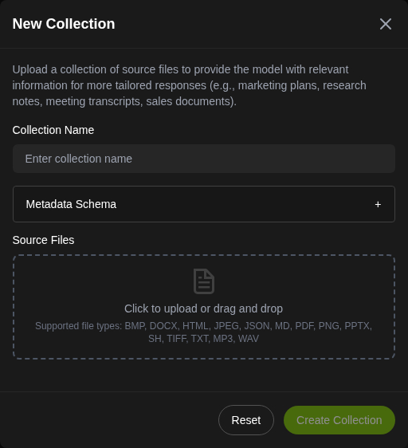
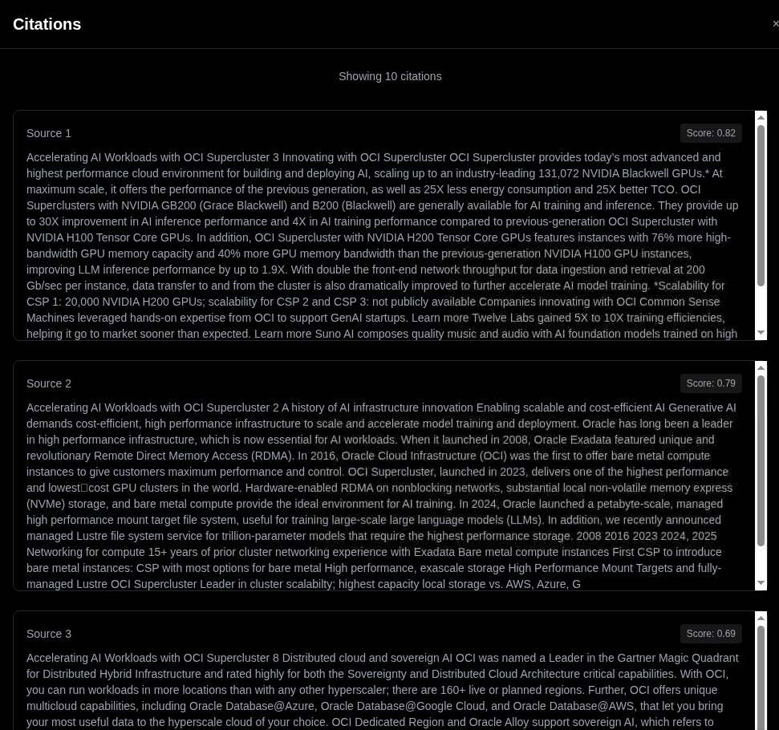

# Lab 2: Deploy and Test RAG

## Introduction

Deploy the two-GPU RAG profile and validate document ingestion and question answering through the platform-owned HTTP route.

### Objectives

- Install RAG and wait for the local model services.
- Upload the OCI PDF and inspect the answer's document sources.

Estimated Time: 45 minutes, including model startup.

## Prerequisites

Complete Lab 1 in this variant. Keep its Cloud Shell session and exported variables available.

## Task 1: Deploy RAG Blueprint 2.6.0

1. Confirm that Cloud Shell uses Helm 3. RAG 2.6.0 failed validation with Helm
   4 because the rendered deployment contained a duplicate environment variable.

    ```bash
    <copy>
    helm version --short
    </copy>
    ```

    Continue only when the reported client major version is `v3`.

2. Deploy RAG into the assigned namespace. The command deliberately keeps the
   frontend internal (`ClusterIP`) because its public URL is platform-managed.

    ```bash
    <copy>
    helm upgrade --install rag \
      https://helm.ngc.nvidia.com/nvidia/blueprint/charts/nvidia-blueprint-rag-v2.6.0.tgz \
      --namespace "$LAB_NAMESPACE" \
      --username '$oauthtoken' \
      --password "$NGC_API_KEY" \
      --reset-values \
      --set-string imagePullSecret.password="$NGC_API_KEY",ngcApiSecret.password="$NGC_API_KEY" \
      --set frontend.service.type=ClusterIP \
      --set-string seaweedfs.image.repository=docker.io/chrislusf/seaweedfs \
      --set server.workers=4,nv-ingest.redis.replica.replicaCount=0 \
      --set nv-ingest.resources.limits.cpu=24,nv-ingest.resources.limits.memory=24Gi \
      --set nimOperator.nim-llm.enabled=true \
      --set-json 'nimOperator.nim-llm.tolerations=[{"key":"nvidia.com/gpu","operator":"Equal","value":"present","effect":"NoSchedule"}]' \
      --set nimOperator.nim-llm.image.repository=nvcr.io/nim/nvidia/nemotron-3.5-lightning-30b-a3b \
      --set-string 'nimOperator.nim-llm.image.tag=2.0.9-variant,nimOperator.nim-llm.model.engine=vllm,nimOperator.nim-llm.model.precision=int4,nimOperator.nim-llm.model.tensorParallelism=1,nimOperator.nim-llm.model.profiles[0]=2ef85c7286907e706eb0d6c4750a1aefa719447097d151ab34c7837fc02bdac4,nimOperator.nim-llm.storage.pvc.size=200Gi,nimOperator.nvidia-nim-llama-nemotron-embed-1b-v2.storage.pvc.size=200Gi' \
      --set 'nimOperator.nim-llm.resources.requests.nvidia\.com/gpu=1,nimOperator.nim-llm.resources.limits.nvidia\.com/gpu=1' \
      --set-json 'nimOperator.nim-llm.env=[{"name":"NIM_HTTP_API_PORT","value":"8000"},{"name":"NIM_TRITON_LOG_VERBOSE","value":"1"},{"name":"NIM_SERVED_MODEL_NAME","value":"nvidia/nemotron-3.5-lightning"},{"name":"NIM_MODEL_PROFILE","value":"2ef85c7286907e706eb0d6c4750a1aefa719447097d151ab34c7837fc02bdac4"}]' \
      --set-string envVars.APP_LLM_MODELNAME=nvidia/nemotron-3.5-lightning,envVars.APP_QUERYREWRITER_MODELNAME=nvidia/nemotron-3.5-lightning,envVars.APP_FILTEREXPRESSIONGENERATOR_MODELNAME=nvidia/nemotron-3.5-lightning,envVars.REFLECTION_LLM=nvidia/nemotron-3.5-lightning,envVars.LLM_ENABLE_THINKING=false,envVars.LLM_MAX_TOKENS=2048 \
      --set nimOperator.nvidia-nim-llama-nemotron-embed-1b-v2.enabled=true,nimOperator.nvidia-nim-llama-nemotron-embed-vl-1b-v2.enabled=false,nimOperator.nvidia-nim-llama-nemotron-rerank-1b-v2.enabled=false \
      --set-json 'nimOperator.nvidia-nim-llama-nemotron-embed-1b-v2.tolerations=[{"key":"nvidia.com/gpu","operator":"Equal","value":"present","effect":"NoSchedule"}]' \
      --set nimOperator.nvidia-nim-llama-nemotron-rerank-vl-1b-v2.enabled=false \
      --set 'nimOperator.nvidia-nim-llama-nemotron-embed-1b-v2.resources.requests.nvidia\.com/gpu=1,nimOperator.nvidia-nim-llama-nemotron-embed-1b-v2.resources.limits.nvidia\.com/gpu=1' \
      --set-string envVars.APP_EMBEDDINGS_SERVERURL=nemotron-embedding-ms:8000/v1,envVars.APP_EMBEDDINGS_MODELNAME=nvidia/llama-nemotron-embed-1b-v2,ingestor-server.envVars.APP_EMBEDDINGS_SERVERURL=nemotron-embedding-ms:8000/v1,ingestor-server.envVars.APP_EMBEDDINGS_MODELNAME=nvidia/llama-nemotron-embed-1b-v2,nv-ingest.envVars.EMBEDDING_NIM_ENDPOINT=http://nemotron-embedding-ms:8000/v1,nv-ingest.envVars.EMBEDDING_NIM_MODEL_NAME=nvidia/llama-nemotron-embed-1b-v2 \
      --set-string envVars.ENABLE_RERANKER=True,envVars.APP_RANKING_MODELNAME=nvidia/llama-nemotron-rerank-vl-1b-v2,envVars.APP_RANKING_SERVERURL=https://ai.api.nvidia.com,envVars.ENABLE_VLM_RERANKER_IMAGE_INPUT=False \
      --set nv-ingest.nimOperator.ocr.enabled=false,nv-ingest.nimOperator.graphic_elements.enabled=false,nv-ingest.nimOperator.page_elements.enabled=false,nv-ingest.nimOperator.table_structure.enabled=false \
      --set-string ingestor-server.envVars.APP_NVINGEST_PDFEXTRACTMETHOD=pdfium,ingestor-server.envVars.APP_NVINGEST_EXTRACTTABLES=False,ingestor-server.envVars.APP_NVINGEST_EXTRACTCHARTS=False,nv-ingest.envVars.COMPONENTS_TO_READY_CHECK= \
      --wait=false
    </copy>
    ```

    Reranking uses NVIDIA's hosted VL reranker with text-only input. Its local
    NIM stays disabled, so the workshop uses only two GPUs.

    Place the memory-heavy ingestor on a GPU worker's CPU and RAM. Without
    this placement, concurrent attendees can exhaust the smaller CPU workers
    even when the GPU workers have ample memory. The selector chooses a GPU
    worker; the toleration allows scheduling past its existing taint. Neither
    setting requests another GPU, so this remains a two-GPU workshop.

3. Chart 2.6.0's ingestor template does not render tolerations. Apply this
    namespace-scoped patch after every RAG Helm install or upgrade, including
    upgrades that use `--reset-values`. It uses your existing Deployment patch
    permission, not `deployments/scale`, and does not change OCI networking or
    the shared node taints. A no-surge rollout avoids reserving memory for a
    second ingestor while replacing the first; ingestion is briefly unavailable.

    ```bash
    <copy>
    kubectl --namespace "$LAB_NAMESPACE" patch deployment ingestor-server --type=merge \
      -p='{"spec":{"strategy":{"type":"RollingUpdate","rollingUpdate":{"maxSurge":0,"maxUnavailable":1}},"template":{"spec":{"nodeSelector":{"nvidia.com/gpu.present":"true"},"tolerations":[{"key":"nvidia.com/gpu","operator":"Equal","value":"present","effect":"NoSchedule"}]}}}}'
    </copy>
    ```

    Continue with the patches in step 6 before waiting for all services. Once
    those checks finish, confirm `ingestor-server` is `1/1` Ready with
    `kubectl --namespace "$LAB_NAMESPACE" get deployment ingestor-server`.
    If it remains Pending, inspect its events and ask the facilitator for help;
    do not increase GPU quota or remove node taints.

4. Allow model-cache pods onto the GPU workers. Chart 2.6.0's LLM
    template does not forward tolerations to its NIMCache. Repeat this after
    each install or upgrade; it needs only your namespaced permissions.

    ```bash
    <copy>
    kubectl --namespace "$LAB_NAMESPACE" patch nimcache nim-llm-cache --type=merge \
      -p='{"spec":{"tolerations":[{"key":"nvidia.com/gpu","operator":"Equal","value":"present","effect":"NoSchedule"}]}}'

    for cache_pod in nim-llm-cache-pod nemotron-embedding-ms-cache-pod; do
      if [ "$(kubectl --namespace "$LAB_NAMESPACE" get pod "$cache_pod" -o jsonpath='{.status.phase}' 2>/dev/null)" = Pending ] && \
         ! kubectl --namespace "$LAB_NAMESPACE" get pod "$cache_pod" -o jsonpath='{.spec.tolerations[*].key}' | grep -Fq 'nvidia.com/gpu'; then
        kubectl --namespace "$LAB_NAMESPACE" patch pod "$cache_pod" --type=json \
          -p='[{"op":"add","path":"/spec/tolerations/-","value":{"key":"nvidia.com/gpu","operator":"Equal","value":"present","effect":"NoSchedule"}}]'
      fi
    done
    </copy>
    ```

    Expect the caches to receive node assignments and their PVCs to bind before
    model downloads finish. `DiskPressure` or ephemeral-storage eviction needs
    facilitator assistance, not a GPU-quota increase or attendee network changes.

5. Check the initial pod status, then apply the SeaweedFS image and RAG
    update-strategy patches below before waiting for services to become ready.

    ```bash
    <copy>
    kubectl get pods -n "$LAB_NAMESPACE" -o wide
    </copy>
    ```

    > **Note:** Some pods may still show `Pending` or `ContainerCreating` at
    > this stage. Do not wait for all pods to become ready before running the
    > two `kubectl patch` commands below. Apply both patches immediately, then
    > run the rollout and readiness checks that follow. If pods remain
    > `Pending` after the patches, use the troubleshooting lab to investigate.

    The first model startup took about 16 minutes in previous tests;
    cold downloads can take longer. Temporary volume-mount retries can
    resolve while the model cache is being attached.

6. Apply the storage-image and RAG update-strategy settings, then wait for
   readiness.

    SeaweedFS provides the object storage used by the RAG application for
    uploaded files. The first patch sets its container image explicitly to
    `docker.io/chrislusf/seaweedfs:3.73`: the registry, repository, and version
    used for this workshop. The fully qualified name avoids relying on the
    worker's registry search settings to resolve a short image name. This
    updates the existing Deployment; it does not delete its persistent volumes.

    The second patch makes the RAG server update one pod at a time without a
    surge pod. This avoids exceeding the namespace memory quota during upgrades;
    RAG is briefly
    unavailable while its single backend pod is replaced. Documents remain
    stored in Elasticsearch and the persistent object store.

    ```bash
    <copy>
    kubectl patch deployment rag-seaweedfs-all-in-one --type=json \
      -p='[{"op":"replace","path":"/spec/template/spec/containers/0/image","value":"docker.io/chrislusf/seaweedfs:3.73"}]'
    </copy>
    ```
    ```bash
    <copy>
    kubectl patch deployment rag-server --type=merge \
      -p='{"spec":{"strategy":{"type":"RollingUpdate","rollingUpdate":{"maxSurge":0,"maxUnavailable":1}}}}'
    </copy>
    ```
    ```bash
    <copy>
    kubectl rollout status deployment/rag-server --timeout=20m
    </copy>
    ```
    ```bash
    <copy>
    kubectl wait --for=jsonpath='{.status.state}'=Ready nimservice --all --timeout=90m
    </copy>
    ```
    ```bash
    <copy>
    kubectl wait --for=jsonpath='{.status.phase}'=Ready elasticsearch --all --timeout=30m
    </copy>
    ```
    ```bash
    <copy>
    kubectl rollout status deployment/rag-frontend --timeout=20m
    </copy>
    ```

    This sandbox uses one Elasticsearch node. `yellow` health is expected when
    all primary shards are active but replica shards cannot be placed on a second
    node; it does not block the ingestion and query exercise. Do not wait for
    `green`, add another node, or delete replicas merely to change the color.
    If the phase is not `Ready`, health is `red`, or ingestion fails, ask the
    facilitator to inspect the cluster health and unassigned primary shards.
    See [Elastic's cluster-health guidance](https://www.elastic.co/docs/troubleshoot/elasticsearch/red-yellow-cluster-status).

## Task 2: Open and validate RAG

1. Confirm the two NIM services are ready and open the RAG URL supplied by the
   workshop environment:

    The terminal-style panels below show **example output**, not commands to
    run. Ages and IP addresses will differ in your environment.

    ```bash
    <copy>
    kubectl get nimservice
    </copy>
    ```

    Expected output: both services report `Ready`.

    <pre style="background-color: #000; color: #fff; padding: 1em; border-radius: 4px; overflow-x: auto;">NAME                    STATUS   AGE
    nemotron-embedding-ms   Ready    20m
    nim-llm                 Ready    20m</pre>

    ```bash
    <copy>
    kubectl get elasticsearch
    </copy>
    ```

    Expected output: one available node and phase `Ready`. Single-node `yellow`
    health is acceptable, as explained in Task 1.

    <pre style="background-color: #000; color: #fff; padding: 1em; border-radius: 4px; overflow-x: auto;">NAME                    HEALTH   NODES   VERSION   PHASE   AGE
    rag-eck-elasticsearch   yellow   1       9.3.0     Ready   20m</pre>

    ```bash
    <copy>
    kubectl get service rag-frontend
    </copy>
    ```

    Expected output: a `ClusterIP` Service on port `3000`. An external IP is
    not needed because the platform-managed route exposes the frontend.

    <pre style="background-color: #000; color: #fff; padding: 1em; border-radius: 4px; overflow-x: auto;">NAME           TYPE        CLUSTER-IP    EXTERNAL-IP   PORT(S)    AGE
    rag-frontend   ClusterIP   10.96.0.100   &lt;none&gt;        3000/TCP   20m</pre>

    ```bash
    <copy>
    printf '%s\n' "$RAG_APP_URL"
    </copy>
    ```

    Expected output: your reservation's RAG portal URL. The hostname below is
    illustrative; use the URL printed by your command.

    <pre style="background-color: #000; color: #fff; padding: 1em; border-radius: 4px; overflow-x: auto;">http://rag-123456.203.0.113.10.nip.io/</pre>

2. Download the [OCI Supercluster PDF](https://www.oracle.com/a/ocom/docs/cloud/accelerate-ai-with-oci-supercluster.pdf)
   to your computer. If the link opens the PDF in your browser, use the PDF
   viewer's download button and save the file locally so you can upload it in
   the next step.

3. Open the RAG portal using the URL printed in step 1. Create a collection
   named **OCI Documentation**, attach the PDF you downloaded, and submit the
   collection for ingestion. Wait until the document finishes processing and
   is available before asking a question.

    

4. Select the **OCI Documentation** collection and submit this question:

    ```text
    <copy>
    What is OCI Supercluster and what makes it unique?
    </copy>
    ```

    Review the answer and expand its source references. Confirm that the cited
    passages from the uploaded PDF support the answer. Multiple passages from
    one PDF are not independent sources; exact wording can vary between runs.

    

## Conclusion

The RAG application is reachable and can answer a question using the uploaded document.

Continue to [Lab 3: Deploy and Test AI-Q](../deploy-aiq-research-assistant/deploy-aiq-research-assistant-sandbox-lite.md).

## Acknowledgements

- **Authors:** Oracle and NVIDIA workshop team
- **Last Updated:** October 2026
