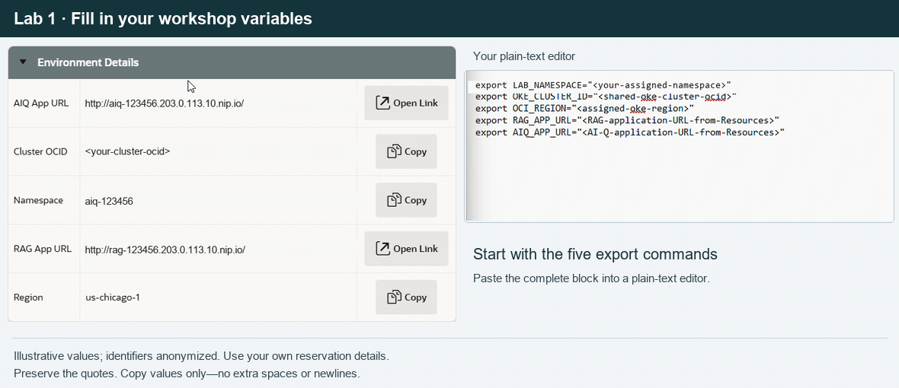

# Lab 1: Prepare the Environment

## Introduction

Connect OCI Cloud Shell to your assigned namespace and prepare application credentials without exposing secrets.

### Objectives

- Download kubeconfig and verify namespaced access.
- Create the AI-Q credential Secret; let RAG Helm own its Secrets.

Estimated Time: 10 minutes.

## Prerequisites

Complete Get Started and obtain the Resources values and API keys listed in the Introduction.

> **Note for Mac users:** Commands must use straight double quotes (`"`), not curly or smart quotes (`“` and `”`), which can cause errors in the console. When editing commands before pasting them into OCI Cloud Shell, use a plain-text editor such as Notepad or TextPad, or TextEdit on macOS in plain-text mode with smart quotes disabled. Check that double quotes remain straight before running the command.

### Open OCI Cloud Shell

1. Sign in to the **OCI Console** using the login information described in
    the Introduction. For a LiveLabs reservation, use **View Login Info** and
    **Launch OCI** to open the console with your assigned credentials.

2. In the OCI Console header, select the region assigned to your workshop.

3. Click the **Cloud Shell/Code Editor** icon in the console header, then
    select **Cloud Shell** from the menu.

4. Wait for the terminal panel to open and display a command prompt. Enter
    the commands in this lab in that panel. Keep the same Cloud Shell session
    open as you work through the workshop.

For additional details, see Oracle's [Using Cloud Shell](https://docs.oracle.com/en-us/iaas/Content/API/Concepts/devcloudshellgettingstarted.htm).

## Task 1: Connect Cloud Shell to the assigned namespace

1. Copy the **Cloud Shell setup commands** from the LiveLabs Resources tab.
   They contain the assigned namespace, cluster OCID, region, kubeconfig
   download command, and both HTTP application URLs. If only individual
   values are displayed, set them below using the supplied values.

    ```bash
    <copy>
    export LAB_NAMESPACE="<your-assigned-namespace>"
    export OKE_CLUSTER_ID="<shared-oke-cluster-ocid>"
    export OCI_REGION="<assigned-oke-region>"
    export RAG_APP_URL="<RAG-application-URL-from-Resources>"
    export AIQ_APP_URL="<AI-Q-application-URL-from-Resources>"
    </copy>
    ```

    You can paste this block into a plain-text editor and replace each
    placeholder with its value from **Environment Details**, as shown below.
    Keep the straight quotes and copy only the value, without extra spaces or
    newlines. The animation uses anonymized examples; use your own reservation.

    

    > **NOTE:** Use a plain-text editor, such as Notepad or Visual Studio Code—not
    > Microsoft Word or another tool that automatically beautifies text. Smart
    > quotes can replace the straight double quotes (`"`) with curly quotes
    > (`“` and `”`), breaking command execution. Disable smart quotes and other
    > automatic formatting before editing or copying these commands.

2. If you used the setup commands, the kubeconfig is already downloaded.
   Otherwise, run the following commands. Access is scoped by your IAM and
   Kubernetes permissions; the kubeconfig selects the shared cluster.
   `--with-auth-context` preserves the OCI authentication settings used when
   downloading it.

    ```bash
    <copy>
    mkdir -p "$HOME/.kube"
    </copy>
    ```
    ```bash
    <copy>
    export KUBECONFIG="$HOME/.kube/${LAB_NAMESPACE}.yaml"
    </copy>
    ```
    ```bash
    <copy>
    oci ce cluster create-kubeconfig \
      --cluster-id "$OKE_CLUSTER_ID" \
      --file "$KUBECONFIG" \
      --region "$OCI_REGION" \
      --token-version 2.0.0 \
      --kube-endpoint PUBLIC_ENDPOINT \
      --with-auth-context
    </copy>
    ```
    ```bash
    <copy>
    kubectl config set-context --current --namespace="$LAB_NAMESPACE"
    </copy>
    ```

    Expected output (your context name will differ):

    ```text
    <copy>
    Context "context-NVIDIA-c6hijvwguia" modified.
    </copy>
    ```

    Check for pods in your assigned namespace:

    ```bash
    <copy>
    kubectl get pods
    </copy>
    ```

    Expected output for a new namespace before deploying the applications:

    ```text
    <copy>
    No resources found in aiq-241135 namespace.
    </copy>
    ```

    Your namespace name will match `$LAB_NAMESPACE`. This message is expected
    when no pods have been deployed yet; you can continue to the next step.

3. Verify the chart-required namespaced APIs. All authorization checks must
   return `yes`.

    ```bash
    <copy>
    kubectl auth can-i create nimservices.apps.nvidia.com
    </copy>
    ```
    ```bash
    <copy>
    kubectl auth can-i create nimcaches.apps.nvidia.com
    </copy>
    ```
    ```bash
    <copy>
    kubectl auth can-i create elasticsearches.elasticsearch.k8s.elastic.co
    </copy>
    ```
    ```bash
    <copy>
    kubectl auth can-i create networkpolicies.networking.k8s.io
    </copy>
    ```
    ```bash
    <copy>
    kubectl get resourcequota
    </copy>
    ```

## Task 2: Configure credentials securely

1. As in Task 1, copy the export block into a **plain-text editor**, replace the
   three API-key placeholders with your own values, and paste the completed
   block into Cloud Shell. Keep the straight double quotes. The database
   password is generated automatically; do not replace that command manually.

    First, run this separate command in Cloud Shell **before pasting keys** so
    the commands containing them are not recorded in Bash history:

    ```bash
    <copy>
    set +o history
    </copy>
    ```

    Then fill in and paste the complete export block:

    ```bash
    <copy>
    export NGC_API_KEY="<your-ngc-api-key>"
    export NVIDIA_API_KEY="<your-nvidia-api-key>"
    export TAVILY_API_KEY="<your-tavily-api-key>"
    export AIQ_DB_PASSWORD="$(openssl rand -hex 32)"
    </copy>
    ```

    If your NGC key also has access to NVIDIA's hosted model APIs, you may use
    the same key for both NVIDIA variables. Otherwise, supply the separate key
    obtained for each service.

    The database command generates 32 random bytes as exactly **64 hexadecimal
    characters (`0–9` and `a–f`)**—no spaces, quotes, slashes, or other special
    characters. PostgreSQL accepts this format, and it is safe for the AI-Q
    chart's database connection URLs, which do not escape passwords. Do not
    substitute Base64. Step 2 checks this exact format before creating the Secret.

    Generate the database password once for a new workshop environment. Do not
    rerun this step to rotate the password of an already initialized database.
    Pasted API keys remain visible in the terminal and clipboard; do not record
    or share them, save the filled-in file, or include them in screenshots.

2. Create only the AI-Q application Secret. RAG Helm creates and owns
   `ngc-secret` and `ngc-api` in Lab 2, Task 1 from the supplied chart values.
   Pre-creating those names causes a Helm release-ownership error.
   The generated database password stays in your shell and the Secret.
    Run this in the same Cloud Shell session. The checks require a 64-character
    hexadecimal password and nonempty API keys. If they fail, correct step 1
    before continuing; do not enable empty database passwords.

    ```bash
    <copy>
    if [[ "$AIQ_DB_PASSWORD" =~ ^[0-9a-f]{64}$ && -n "$NVIDIA_API_KEY" && -n "$TAVILY_API_KEY" ]]; then
    kubectl create secret generic aiq-credentials \
      --from-literal=DB_USER_NAME=aiq \
      --from-literal=DB_USER_PASSWORD="$AIQ_DB_PASSWORD" \
      --from-literal=NVIDIA_API_KEY="$NVIDIA_API_KEY" \
      --from-literal=TAVILY_API_KEY="$TAVILY_API_KEY" \
      --dry-run=client -o yaml | kubectl apply -f -
    else
      printf '%s\n' 'Missing API keys or invalid database password: complete Task 2, step 1 in this shell before continuing.' >&2
    fi
    </copy>
    ```

    After the Secret is created, re-enable Bash history:

    ```bash
    <copy>
    set -o history
    </copy>
    ```

## Conclusion

Cloud Shell uses your assigned namespace and the AI-Q credential Secret is present.

Continue to [Lab 2: Deploy and Test RAG](?lab=deploy-rag-blueprint-sandbox-lite), or select **Lab 2: Deploy and Test RAG** in the workshop navigation menu.

## Acknowledgements

- **Authors:** Oracle and NVIDIA workshop team
- **Last Updated:** October 2026
